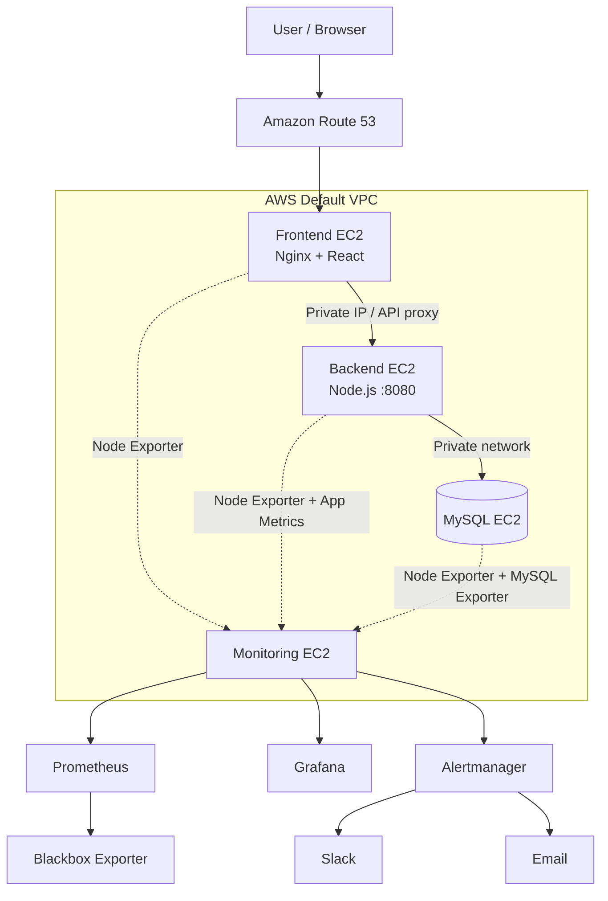

# Expense App Observability on AWS

A Terraform-based AWS deployment of a three-tier expense application with a separate monitoring instance. The project combines EC2 provisioning, Nginx reverse proxying, Route 53 DNS, Prometheus metrics collection, Grafana dashboards and Alertmanager notification configuration.

## Architecture



The infrastructure uses four EC2 instances:

1. Frontend: Nginx and the built React application.
2. Backend: Node.js application.
3. Database: MySQL.
4. Monitoring: Prometheus, Grafana, Alertmanager and Blackbox Exporter.

Terraform uses private IP references for frontend-to-backend and backend-to-database communication. Security groups restrict application-tier communication to the intended upstream components.

## Technology Stack

| Layer | Technologies |
|---|---|
| Cloud | AWS EC2, VPC, Security Groups, Route 53 |
| Infrastructure as Code | Terraform |
| Frontend | React, Nginx |
| Backend | Node.js |
| Database | MySQL |
| Monitoring | Prometheus |
| Exporters | Node Exporter, MySQL Exporter, Blackbox Exporter |
| Dashboards | Grafana |
| Alerting | Alertmanager, Slack, Email |
| DNS | Amazon Route 53 |
| Operating System | Red Hat Enterprise Linux |
| Version Control | Git, GitHub |

## Repository Structure

```text
Expense-App-Observability/
├── .gitattributes
├── .gitignore
├── .terraform.lock.hcl
├── README.md
├── dashboard-01-fleet-overview.json
├── dashboard-02-node-host-use.json
├── dashboard-03-mysql.json
├── dashboard-04-application-red.json
├── dashboard-05-business-metrics.j
├── dashboard-06-blackbox-synthe
├── dashboard-07-slo-error-budget
├── data.tf
├── ec2.tf
├── iam.tf
├── outputs.tf
├── prometheus/
│   ├── alerting-rules.yaml
│   └── recording_rules.yaml
├── r53.tf
├── scripts/
│   ├── load-fault-traffic.sh
│   └── load-healthy-traffic.sh
├── security_groups.tf
├── userdata-grafana-provisioning
├── userdata/
│   ├── backend.sh
│   ├── frontend.sh
│   ├── mysql.sh
│   └── prometheus.sh
├── variables.tf
└── versions.tf
```

**Repository completeness note:** The current GitHub tree contains one populated dashboard JSON file. The other six dashboard files, the Prometheus rule files, the two traffic-generation scripts and `userdata-grafana-provisioning` are currently empty. They are not represented as completed implementations here.

## Infrastructure Provisioning

Terraform provisions four EC2 instances using the AWS provider.

### Infrastructure responsibilities

| File | Responsibility |
|---|---|
| `versions.tf` | Terraform and AWS provider versions |
| `provider.tf` | Not present; provider configuration is in `versions.tf` |
| `data.tf` | Default VPC, subnets and AMI lookup |
| `ec2.tf` | Frontend, backend, MySQL and Prometheus instances |
| `security_groups.tf` | Network access controls |
| `iam.tf` | Prometheus EC2 discovery permissions |
| `r53.tf` | Route 53 DNS records |
| `variables.tf` | Infrastructure and application inputs |
| `outputs.tf` | Instance addresses and infrastructure outputs |

Terraform uses the default VPC and discovers available subnets. It does not provision a custom VPC in this implementation.

The Prometheus instance has an IAM role that permits EC2 service discovery through `DescribeInstances` and `DescribeAvailabilityZones`.

## Monitoring Design

### Prometheus

Prometheus runs on the dedicated monitoring instance.

The bootstrap script configures:
- Prometheus self-monitoring.
- EC2 service discovery.
- Node Exporter metrics.
- MySQL Exporter metrics.
- Backend application metrics.
- Blackbox HTTP/HTTPS probes.

### Grafana

Grafana runs on the monitoring instance and provides a visualization interface for collected metrics.

The repository currently contains one populated dashboard JSON file. Other dashboard files are empty placeholders.

### Alertmanager

Alertmanager is configured to route notifications based on alert severity.

The Terraform inputs include:
- Slack webhook URL.
- Slack channel.
- SMTP host and credentials.
- Email sender and recipient.

The actual monitoring artifact bundle is downloaded during Prometheus instance bootstrap.

### Exporters

| Exporter | Purpose |
|---|---|
| Node Exporter | Host-level metrics |
| MySQL Exporter | MySQL metrics |
| Blackbox Exporter | HTTP/HTTPS endpoint probes |

## External Artifact Dependency

The Terraform variable `artifacts_base_url` defaults to:

`https://raw.githubusercontent.com/daws-90s/expense-prometheus-grafana-docs/main/artifacts`

The bootstrap scripts download the frontend, backend, MySQL and monitoring artifacts from this external location.

Consequently, this repository alone is not sufficient to reproduce every application and monitoring artifact.

Before deployment, verify that the external artifact repository is accessible and that its packaged files match the versions expected by the bootstrap scripts.

For stronger reproducibility, use immutable artifact versions rather than relying on a moving `main` branch.

## Prerequisites

Install the following locally:

- Git
- Terraform 1.7 or later
- AWS CLI
- AWS credentials configured through a secure method
- An AWS account with permission to provision EC2, IAM and Route 53 resources
- A Route 53 hosted zone and domain you control
- An accessible artifact repository

Configure the AWS CLI:

```bash
aws configure
aws sts get-caller-identity
```

The AWS identity must have the permissions required by the Terraform resources.

## Deployment

### 1. Clone the repository

```bash
git clone https://github.com/dhanushgs7/Expense-App-Observability.git

cd Expense-App-Observability
```

### 2. Configure Terraform variables

Create a local `terraform.tfvars` file.

The following variables must be configured:

```hcl
ssh_cidr = "YOUR_PUBLIC_IP/32"

browser_cidr = "YOUR_PUBLIC_IP/32"

route53_zone_id = "YOUR_ROUTE53_HOSTED_ZONE_ID"

domain_name = "YOUR_DOMAIN"

db_root_password = "CHANGE_ME"
db_app_password = "CHANGE_ME"
db_exporter_password = "CHANGE_ME"

alertmanager_smtp_host = "YOUR_SMTP_HOST:587"
alertmanager_smtp_from = "YOUR_SENDER_EMAIL"
alertmanager_smtp_auth_username = "YOUR_SMTP_USERNAME"
alertmanager_smtp_auth_password = "YOUR_SMTP_APP_PASSWORD"

alertmanager_email_to = "YOUR_ALERT_EMAIL"

alertmanager_slack_webhook_url = "YOUR_SLACK_WEBHOOK"
alertmanager_slack_channel = "#alerts"
```

Replace every placeholder with actual values.

Never commit this file.

### 3. Validate Terraform

Run from the repository root:

```bash
terraform fmt -check -recursive

terraform init

terraform validate
```

### 4. Review the deployment plan

```bash
terraform plan
```

Review:
- Number and type of EC2 instances.
- Security group ingress rules.
- IAM permissions.
- Route 53 records.
- EBS volumes.
- Expected AWS costs.

### 5. Deploy infrastructure

Only after reviewing the plan:

```bash
terraform apply
```

### 6. Inspect Terraform outputs

```bash
terraform output
```

Use the outputs to identify the frontend, backend, database and monitoring infrastructure.

## Verification

### AWS infrastructure

```bash
aws ec2 describe-instances \
  --filters "Name=tag:Project,Values=expense"
```

Verify that the four expected instances are running.

### Linux services

On the relevant instances:

```bash
sudo systemctl status nginx

sudo systemctl status backend

sudo systemctl status mysqld

sudo systemctl status prometheus
```

Also verify Grafana, Alertmanager and exporter services on the monitoring instance.

### Prometheus

Open the Prometheus interface on port `9090`.

Check:

- `/targets`
- `up`
- `probe_success`

Confirm that expected targets are healthy.

### Grafana

Open Grafana on port `3000`.

Verify that the configured Prometheus data source is reachable and that populated dashboard panels return data.

### Alertmanager

Open Alertmanager on port `9093`.

Verify configured receivers and test notification delivery using a controlled alert.

### Application

Verify:
- Frontend accessibility.
- Nginx API reverse proxy.
- Backend health endpoint.
- Database connectivity.
- DNS resolution.
- HTTPS behavior.

**TLS note:** The current infrastructure configuration references a demo self-signed certificate. Do not describe this as a Let's Encrypt deployment. A self-signed certificate will not provide normal publicly trusted browser TLS.

## Security Considerations

- Restrict SSH access to a trusted IP or VPN.
- Restrict monitoring interfaces to trusted networks.
- Do not expose MySQL or internal backend ports publicly.
- Never commit AWS credentials, private keys, Slack webhooks or SMTP passwords.
- Keep `terraform.tfstate` outside Git.
- Review Terraform plans before applying changes.
- Use encrypted remote state and locking for shared environments.
- Protect Terraform variables and instance bootstrap secrets.
- Review EC2 public IP and EBS charges.
- Do not use this demonstration application for real financial data.

Terraform currently uses local state; the S3 and DynamoDB backend configuration in `versions.tf` is commented out.

## Screenshots to Add

Create a `docs/images/` directory and add genuine screenshots:

```text
docs/
└── images/
    ├── expense-application.png
    ├── aws-ec2-instances.png
    ├── prometheus-targets.png
    ├── grafana-dashboard.png
    └── slack-alert.png
```

Only add screenshots that correspond to successfully running components. Remove any screenshot entry if the feature has not been demonstrated.

## Design Decisions and Lessons

- Used Terraform to provision infrastructure consistently.
- Separated frontend, backend, database and monitoring responsibilities.
- Used private IP references for internal application communication.
- Restricted tier-to-tier access through security groups.
- Used EC2 service discovery instead of maintaining static Prometheus targets.
- Used an IAM instance profile for Prometheus discovery instead of embedding AWS access keys.
- Used exporters to expose host and database metrics.
- Used Blackbox Exporter for endpoint availability checks.
- Used Alertmanager for notification routing.

## Known Limitations and Next Improvements

1. Commit the actual Prometheus recording and alerting rule files.
2. Populate the empty Grafana dashboard files or remove unused placeholders.
3. Add reproducible Grafana provisioning configuration.
4. Add the traffic-generation scripts if they are part of the intended demonstration.
5. Replace the self-signed demo certificate with a publicly trusted TLS certificate.
6. Move external artifact dependencies to versioned, immutable releases.
7. Implement an encrypted remote Terraform state backend with locking.
8. Add authentication and access control to monitoring interfaces.
9. Add reproducible validation for the application and monitoring configuration.

## Author

**Dhanush G S**

GitHub: [github.com/dhanushgs7](https://github.com/dhanushgs7)

LinkedIn: [linkedin.com/in/dhanushgs7](https://www.linkedin.com/in/dhanushgs7)

