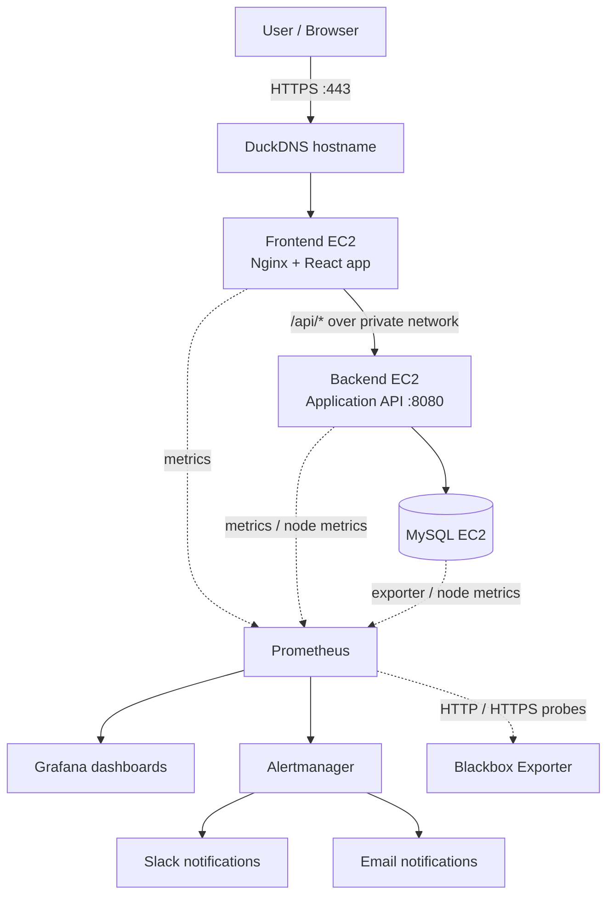

# Expense App Observability

A cloud-hosted expense-tracking application deployed on AWS and monitored with Prometheus, Grafana, and Alertmanager. This project combines infrastructure provisioning, web serving, application health checks, metrics, dashboards, and alert notifications.

> **Live demo:** [https://dhanush-expense-lab.duckdns.org](https://dhanush-expense-lab.duckdns.org)  
> This is a learning demo on a free DuckDNS subdomain and may change or become unavailable. Do not use it for sensitive or real financial data.

## Project Highlights

- Deployed a React-based expense application on AWS EC2.
- Provisioned cloud infrastructure with Terraform.
- Served the frontend with Nginx on Red Hat Enterprise Linux 9.
- Routed `/api/` requests from Nginx to a backend service over the private network.
- Configured a DuckDNS hostname and HTTPS using Let's Encrypt and Certbot.
- Collected infrastructure and application metrics with Prometheus and exporters.
- Built Grafana dashboards for application request rate, latency, status codes, and infrastructure health.
- Configured Alertmanager notifications to Slack and email.
- Used Blackbox Exporter probes to monitor HTTP/HTTPS endpoint availability.

## Architecture



This is a high-level diagram. Confirm exporter placement and scrape paths against the current configuration before changing the deployment.

## Technology Stack

| Area | Technologies |
|---|---|
| Cloud | AWS EC2, Security Groups, Route 53 resources used during DNS experiments |
| Infrastructure as Code | Terraform |
| Frontend / web server | React, Nginx |
| Backend | Application API on port `8080` |
| Database | MySQL |
| Operating system | Red Hat Enterprise Linux 9.7 on the frontend instance |
| DNS and TLS | DuckDNS, Let's Encrypt, Certbot |
| Monitoring | Prometheus, Node Exporter, MySQL Exporter, Blackbox Exporter |
| Visualization | Grafana |
| Alerting | Alertmanager, Slack, email |
| Version control | Git, GitHub |

## Application Access

- **HTTPS:** https://dhanush-expense-lab.duckdns.org
- **HTTP:** http://dhanush-expense-lab.duckdns.org
- **Direct IP (troubleshooting only):** `http://3.80.209.100`

Use the hostname rather than the IP address for HTTPS because the certificate is issued for the hostname. Avoid entering real personal or financial information into a public demo.

## Monitoring and Observability

### Prometheus

Prometheus scrapes the configured application, host, database-exporter, and probe targets. Use the Targets page to check scrape status and the expression browser to inspect metrics.

Example PromQL queries:

```promql
up
```

Shows whether configured scrape targets are reachable by Prometheus.

```promql
probe_success
```

Shows the result for configured Blackbox probes (`1` for success and `0` for failure).

```promql
ALERTS{alertstate="firing"}
```

Lists currently firing alert series.

A target being `UP` means Prometheus can scrape that target; it does not necessarily mean an HTTP endpoint probe or the application itself is healthy. Check `probe_success` and application-specific metrics too.

### Grafana

Grafana dashboards help review application and infrastructure behavior, including request rate, latency, status codes, and host metrics. Dashboard panels depend on the metrics and labels actually exposed by the application and exporters.

### Alertmanager

Alertmanager routes configured alerts to Slack and email. Verify delivery with a controlled test alert and confirm that the alert resolves when the underlying condition clears. Do not publish webhook URLs, SMTP credentials, tokens, or other notification secrets.

### Blackbox Exporter

Blackbox probes test configured HTTP/HTTPS endpoints, including the public application URL and backend health endpoint. A failed probe may be caused by DNS, network access, TLS configuration, or the endpoint itself; inspect probe results before changing alert rules.

## Repository Layout

The exact layout may evolve. A typical layout could look like this:

```text
Expense-App-Observability/
├── terraform/                 # Terraform configuration, if kept here
├── userdata/                  # EC2 bootstrap/user-data scripts, if present
├── prometheus/                # Prometheus configuration, if present
├── grafana/                   # Dashboard/provisioning files, if present
├── alertmanager/              # Alert routing configuration, if present
└── README.md
```

Update this tree to match the actual repository before publishing; remove entries that do not exist.

## Deployment Guide

These are general workflow steps. Run Terraform commands from the directory containing the project's root Terraform configuration files.

### 1. Prerequisites

- An AWS account and credentials configured locally.
- Terraform and AWS CLI installed.
- Git installed.
- SSH access to the EC2 instances.
- A domain or subdomain you control if reproducing the public DNS and HTTPS setup.

### 2. Clone the repository

```bash
git clone https://github.com/dhanushgs7/Expense-App-Observability.git
cd Expense-App-Observability
```

### 3. Review configuration

Inspect Terraform variables, provider region, instance settings, security groups, user-data scripts, and monitoring configuration. Supply required values using a local `.tfvars` file or environment variables as expected by the project.

Never commit AWS access keys, DuckDNS tokens, SSH private keys, SMTP passwords, Slack webhook URLs, secret-bearing `.tfvars` files, or Terraform state files.

### 4. Validate and plan Terraform

From the Terraform root directory:

```bash
terraform fmt -check
terraform init
terraform validate
terraform plan
```

Review the plan carefully before applying it. Confirm that it will not unintentionally replace or destroy working resources.

### 5. Deploy infrastructure

Only after reviewing the plan and confirming the account, region, costs, and resource changes:

```bash
terraform apply
```

Follow the prompts and store outputs securely. Actual variable names, module layout, and deployment commands depend on the Terraform files in this repository.

### 6. Configure DNS and HTTPS

1. Point a hostname you control to the frontend's public IP.
2. Confirm public DNS resolution before requesting a certificate.
3. Allow inbound TCP `80` for HTTP validation and TCP `443` for HTTPS, according to your intended public access.
4. Configure Nginx to serve the app and proxy API requests.
5. Obtain and configure a certificate for that exact hostname.
6. Test the Nginx configuration before reloading it:

```bash
sudo nginx -t
sudo systemctl reload nginx
```

The current demo uses DuckDNS and Certbot/Let's Encrypt. Certificate issuance and renewal depend on public DNS and successful validation. Never commit a private key.

### 7. Verify the deployment

- Open the app and test adding and viewing an expense.
- Verify API requests and database connectivity.
- Check Prometheus targets and probe results.
- Open Grafana and verify dashboard panels have data.
- Check Alertmanager status and test Slack/email delivery.
- Confirm HTTPS works without a browser certificate warning.

## Security Notes

- Restrict SSH (`TCP 22`) to your own trusted IP or VPN rather than exposing it to `0.0.0.0/0`.
- Expose only the ports that need public access. Do not expose MySQL (`3306`), internal backend ports, Prometheus (`9090`), Grafana (`3000`), or Alertmanager (`9093`) publicly unless that access is deliberately designed and secured.
- Keep the database and backend on private network paths where possible.
- Store credentials and notification tokens in a secrets manager or protected local configuration, not in Git.
- Do not commit `terraform.tfstate`, `terraform.tfstate.backup`, private keys, `.env` files, or secret-bearing variable files.
- Review Terraform plans before applying them, and remove lab resources when no longer needed to avoid unexpected AWS charges.
- This is a learning project, not a production-hardened financial service. Do not enter sensitive financial information.

## Screenshots

Add screenshots to a repository folder such as `docs/images/` and update the paths below. Do not include credentials, tokens, email addresses, or other sensitive information.

```md


```

## Troubleshooting

| Symptom | Checks |
|---|---|
| App does not load | Check EC2 status checks, security group rules, Nginx status, and port `80`/`443` reachability. |
| Hostname does not resolve | Check the DuckDNS record, current public IP, and DNS resolution from a public resolver. |
| HTTPS certificate error | Confirm the URL hostname matches the certificate and that the certificate is valid and renewed. |
| API requests fail | Check Nginx `/api/` proxy configuration, backend service status, backend port access, and application logs. |
| Prometheus target is down | Check target address, exporter service, network access, and Prometheus scrape configuration. |
| Probe fails while target is UP | Check `probe_success`, probe error details, DNS, TLS, and endpoint reachability. |
| Grafana panel has no data | Confirm the data source, time range, query, metric name, and label filters. |
| Slack/email alert missing | Check alert state, Alertmanager routing, receiver configuration, and notification logs without exposing secrets. |

## What I Learned

- Provisioning and managing AWS infrastructure with Terraform.
- Deploying a multi-tier application across EC2 instances.
- Using Nginx to serve a frontend and reverse-proxy API requests.
- Configuring DNS and HTTPS for a public hostname.
- Collecting infrastructure, application, and endpoint-probe metrics.
- Building dashboards and configuring alert notifications.
- Troubleshooting DNS, web-server, application, and monitoring issues.

## Future Improvements

- Add CI/CD for automated testing and deployment.
- Store secrets in AWS Secrets Manager or Systems Manager Parameter Store.
- Monitor certificate expiry and verify renewal automatically.
- Add authentication and access controls for monitoring interfaces.
- Add automated backups and documented recovery procedures.
- Add reproducible tests and infrastructure cost controls.

## Author

**Dhanush G S**  
GitHub: [@dhanushgs7](https://github.com/dhanushgs7)

---

If you reuse or adapt this project, review the infrastructure configuration and security settings for your own environment before deploying.
